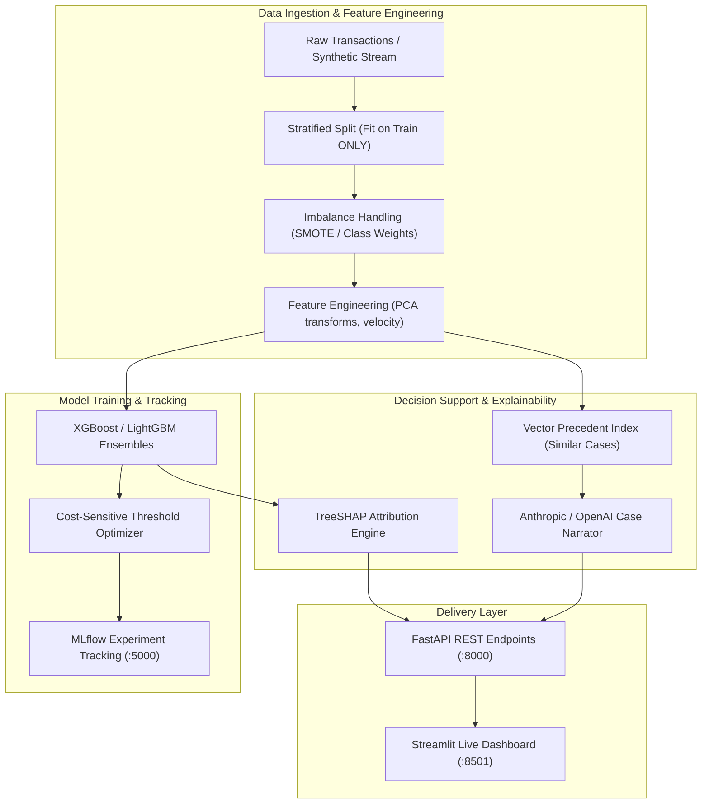

# FraudLens

<p align="center">
  
</p>

<p align="center">
  
  
  
  
  
  <a href="./LICENSE"></a>
</p>

> A production-grade credit card fraud detection and explainability system. It integrates supervised gradient-boosted ensembles (XGBoost, LightGBM, Random Forest), per-transaction SHAP feature attributions, plain-English LLM case narratives, RAG-based precedent case retrieval, and live Streamlit monitoring across 457 automated tests.

**Status:** Prototype portfolio project. Built to demonstrate anti-leakage data pipelines, cost-sensitive threshold optimization, TreeSHAP explainability, and real-time model serving.

<!-- TODO[L2-01]: Add a screenshot of the Streamlit live monitor and SHAP breakdown to docs/assets/dashboard.png (owner: Maintainer) -->

<p align="center">
  <a href="#what-it-does">What It Does</a> •
  <a href="#quick-facts">Quick Facts</a> •
  <a href="#architecture">Architecture</a> •
  <a href="#tech-stack">Tech Stack</a> •
  <a href="#engineering-features">Engineering Features</a> •
  <a href="#quick-start">Quick Start</a> •
  <a href="#configuration">Configuration</a> •
  <a href="#testing">Testing</a> •
  <a href="./LICENSE">License</a>
</p>

---

## What It Does

FraudLens provides end-to-end tooling for financial fraud prevention:

1. **Supervised Classification:** Detects transaction anomalies on highly imbalanced credit card datasets using tuned XGBoost, LightGBM, and Random Forest models with cost-sensitive threshold tuning.
2. **Strict Data Leakage Prevention:** Scalers, imputation baselines, and feature transformations are fit strictly on training splits before transforming test data, ensuring zero data leakage.
3. **Transparent Model Explainability:** Computes exact TreeSHAP values for every transaction, pinpointing which specific features (e.g., transaction amount, velocity, location shift) drove the risk score.
4. **LLM Case Narratives:** Translates mathematical SHAP vectors and transaction metadata into plain-English case narratives to aid human fraud analysts during manual review.
5. **Precedent Retrieval (RAG):** Embeds past confirmed fraud cases in a vector index to retrieve similar historical incidents alongside incoming alerts.
6. **Multi-Interface Deployment:** Exposes high-throughput prediction endpoints via FastAPI (`:8000`), a live investigation dashboard via Streamlit (`:8501`), and experiment tracking via MLflow (`:5000`).

---

## Quick Facts

| Dimension | Specification | Evidence Source |
|:---|:---|:---|
| Project Type | Machine Learning System / Real-Time Fraud Classification | `pyproject.toml`, `requirements.txt` |
| Primary Language | Python (>= 3.12) | `pyproject.toml:8`, `Dockerfile` |
| ML & Data Modeling | XGBoost, LightGBM, Scikit-learn, Imbalanced-learn (SMOTE/ADASYN) | `requirements.txt` |
| Explainability Engine | SHAP (TreeSHAP) | `src/explain/`, `requirements.txt` |
| API & Web Framework | FastAPI (v0.115+), Streamlit (v1.40+) | `api/main.py`, `app/dashboard.py` |
| Experiment Tracking | MLflow (`mlruns/`, SQLite backend) | `requirements.txt`, `Makefile` |
| Test Suite | 457 collected tests across 28 test modules | `tests/` directory (`pytest`) |
| License | MIT License | `LICENSE` file |

---

## Architecture



*Data flow summary: Training pipelines fit preprocessors strictly on the training partition to eliminate leakage. Tuned models pass predictions to the SHAP engine and RAG index, generating real-time risk scores, attribution vectors, and natural-language justifications served through FastAPI and Streamlit.*

---

## Tech Stack

### Data Science & Modeling
- **Runtime:** Python 3.12+
- **Gradient Boosting:** `xgboost>=2.1.0`, `lightgbm>=4.5.0`
- **Machine Learning Core:** `scikit-learn>=1.5.0`, `imbalanced-learn>=0.12.0`
- **Interpretability:** `shap>=0.46.0`
- **Data Manipulation:** `pandas>=2.2.0`, `numpy>=1.26.0`
- **Experiment Tracking:** `mlflow>=2.16.0`

### API & Application Serving
- **REST Service:** FastAPI (`fastapi>=0.115.0`), Uvicorn (`uvicorn[standard]>=0.30.0`)
- **Interactive UI:** Streamlit (`streamlit>=1.40.0`)
- **Database & Migrations:** SQLAlchemy, Alembic, SQLite (`fraudlens.db`) / PostgreSQL
- **Resilience:** Redis rate limiting (`slowapi`), Tenacity retry logic

### Infrastructure
- **Containerization:** Multi-stage `Dockerfile`, Docker Compose (`docker-compose.yml`)

---

## Engineering Features

### Anti-Leakage Pipeline Architecture
A common flaw in fraud detection models is preprocessing the entire dataset before splitting, allowing test set distributions to leak into normalization parameters.
- **Strict Separation:** `src/features/pipeline.py` enforces a rigid `fit` on training data and `transform` on validation/test data protocol.
- **Verification:** Unit tests in [`tests/test_preprocessing.py`](tests/test_preprocessing.py) verify that scaler statistics and imputation values remain isolated to training folds.

### Cost-Sensitive Threshold Optimization
Default classification thresholds (0.5) are suboptimal for severe class imbalances (where fraud constitutes < 0.2% of transactions).
- **Business Loss Formulation:** `src/models/business_cost.py` models expected financial impact: `Cost = (False Positives × Review Cost) + (False Negatives × Average Fraud Value)`.
- The optimal decision threshold is mathematically selected to minimize total financial exposure rather than maximizing raw accuracy.

### Grounded Multi-Stage Explanations
Every flagged transaction generates three complementary layers of explanation:
1. **Mathematical:** Exact SHAP feature importance scores detailing directional impact.
2. **Precedent Retrieval:** Vector similarity search locating the closest past confirmed fraud records.
3. **Analyst Narrative:** An automated plain-language summary recommending concrete investigative actions.

---

## Prerequisites

Before running FraudLens, ensure you have installed:
- **Python:** Version 3.12 or newer (`python --version`)
- **Docker & Docker Compose:** Required for running the containerized multi-service stack
- **Kaggle API Credentials:** Optional, for downloading the original European credit card fraud benchmark dataset

---

## Quick Start

### 1. Clone the repository
```bash
git clone https://github.com/themanoj-025/Credit-Card-Fraud-Detection-System.git
cd Credit-Card-Fraud-Detection-System
```

### 2. Configure Python environment

**On Windows (PowerShell):**
```powershell
python -m venv .venv
.\.venv\Scripts\Activate.ps1
pip install -r requirements.txt
pip install -e .
```

**On Linux / macOS (Bash):**
```bash
python3 -m venv .venv
source .venv/bin/activate
pip install -r requirements.txt
pip install -e .
```

### 3. Set environment configuration
```bash
cp .env.example .env
```
*(On Windows cmd: `copy .env.example .env`).*

### 4. Run the Training Pipeline
Train baseline and XGBoost models, calculate SHAP values, and evaluate performance:
```bash
python run_pipeline.py
```

### 5. Launch the FastAPI Prediction Service
```bash
uvicorn api.main:app --reload --port 8000
```
Interactive API documentation will be available at `http://localhost:8000/docs`.

### 6. Launch the Streamlit Monitoring Dashboard (Separate terminal)
```bash
streamlit run app/dashboard.py
```
Open `http://localhost:8501` to view real-time model metrics and interactive SHAP transaction inspections.

### 7. Launch MLflow Experiment UI (Optional)
```bash
mlflow ui --port 5000
```
Open `http://localhost:5000` to compare hyperparameter runs and ROC-AUC curves.

---

## Docker Deployment

To launch the complete containerized FraudLens stack (FastAPI, Streamlit, and Redis):

```bash
# 1. Prepare environment
cp .env.example .env

# 2. Build and launch services
docker compose up --build -d

# 3. View live logs
docker compose logs -f
```

Access endpoints:
- **FastAPI Documentation:** `http://localhost:8000/docs`
- **Streamlit Dashboard:** `http://localhost:8501`

To stop containers:
```bash
docker compose down
```

---

## Configuration

Settings are parsed in [`src/fraudlens/config.py`](src/fraudlens/config.py) from environment variables or a local `.env` file:

| Variable | Required | Default | Description | Secret |
|:---|:---:|:---|:---|:---:|
| `API_SECRET_KEY` | No | `dev-secret` | Authentication key for protected administrative API endpoints | **Yes** |
| `DATABASE_URL` | No | `sqlite:///./fraudlens.db` | Persistence connection string for transaction logs | **Yes** |
| `REDIS_URL` | No | `redis://localhost:6379/0` | Redis instance for rate limiting and cache | **Yes** |
| `ANTHROPIC_API_KEY` | No | `""` | Optional API key for Claude-powered analyst narratives | **Yes** |
| `OPENAI_API_KEY` | No | `""` | Optional API key for OpenAI-powered analyst narratives | **Yes** |
| `OPTIMAL_THRESHOLD` | No | `0.45` | Default decision boundary probability for fraud classification | No |
| `COST_FP` | No | `10.0` | Estimated operational cost ($) of reviewing a false positive alert | No |
| `COST_FN` | No | `250.0` | Estimated average financial loss ($) of a missed fraud incident | No |

---

## Project Structure

```text
Credit-Card-Fraud-Detection-System/
├── api/                           # FastAPI application endpoints and route routers
│   ├── main.py                    # API entrypoint and lifecycle events
│   └── routers/                   # Endpoints: /predict, /batch, /explain, /health
├── app/                           # Streamlit dashboard application
│   └── dashboard.py               # Live transaction visualizer and SHAP inspector
├── data/                          # Dataset storage (raw, processed, synthetic caches)
├── models/                        # Serialized model artifacts (.joblib, .json)
├── notebooks/                     # Exploratory data analysis and research notebooks
├── reports/                       # Generated evaluation summaries and figures
├── src/                           # Core machine learning package
│   ├── data/                      # Data loaders, Kaggle fetchers, synthetic generators
│   ├── features/                  # Feature engineering, scaling, anti-leakage pipelines
│   ├── models/                    # XGBoost, LightGBM, cost-sensitive threshold optimizer
│   ├── explain/                   # SHAP attribution calculations and LLM narrators
│   └── rag/                       # Historical case vector indexing and similarity search
├── tests/                         # Automated test suite (457 test cases across 28 modules)
├── .env.example                   # Annotated environment variable template
├── Dockerfile                     # Multi-stage production container build
├── docker-compose.yml             # Docker service composition definition
├── Makefile                       # Development task runner
├── pyproject.toml                 # Package definition and tool configurations
├── requirements.txt               # Pinned package dependencies
└── run_pipeline.py                # End-to-end training and evaluation script
```

---

## Testing

The test suite validates data preprocessing, anti-leakage boundaries, model serialization, SHAP generation, and API contracts:

```bash
# Run the complete test suite
pytest tests/ -v

# Run unit tests only
pytest tests/ -m "unit" -v

# Run with coverage report
pytest tests/ --cov=src --cov=api --cov-report=term-missing

# Run documentation anchor, link, and fence validation
python .github/scripts/lint_readme.py
```

---

## Limitations and Threat Model

- **Adversarial Concept Drift:** Fraud patterns evolve rapidly. The system includes drift detection utilities (`src/models/drift.py`), but production models require periodic retraining on recent labeled data.
- **Synthetic Fallback:** When Kaggle benchmark data is not locally present, the training pipeline generates synthetic transactions matching statistical properties of financial data. Real-world evaluation should be run against production transaction logs.
- **Offline Explainability:** While LLM case narratives require external AI API keys, deterministic risk scores and TreeSHAP feature attributions operate entirely offline with zero third-party dependencies.

---

## Contributing

Contributions and model improvements are welcome! Please review [CONTRIBUTING.md](./CONTRIBUTING.md) before submitting pull requests.

1. Fork the repository.
2. Create a feature branch (`git checkout -b feature/isolation-forest-tuning`).
3. Commit your changes following Conventional Commits (`git commit -m 'feat: optimize anomaly detection hyperparameters'`).
4. Ensure all tests and linters pass (`pytest tests/` and `python .github/scripts/lint_readme.py`).
5. Open a Pull Request.

---

## Security

Please report vulnerabilities confidentially according to our security policy in [SECURITY.md](./SECURITY.md). Do not file public issues for active security exploits.

---

## License

This project is licensed under the terms of the MIT License. See [LICENSE](./LICENSE) for details.
